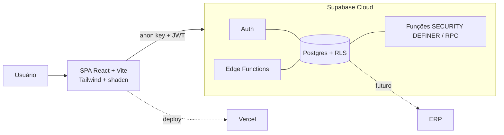

# 02 - Arquitetura

## Visão geral

Aplicação SPA (React) conversando direto com o Supabase via a `anon key`, com toda
a autorização imposta pelo banco (RLS). Lógica pesada e operações privilegiadas
ficam em funções Postgres (`SECURITY DEFINER` com gate) e, quando preciso, em Edge
Functions. Não há backend próprio de API no v1: o Supabase é o backend.

## Por que este desenho

- **RLS como perímetro único de segurança.** Com multi-tenant, tentar controlar
  acesso no frontend é frágil. O banco decide o que cada usuário vê e faz. O
  frontend só pinta o que o banco devolve.
- **Sem camada de API intermediária no v1.** Menos código para manter, menos
  lugar para a regra de acesso divergir. Quando uma regra for complexa demais
  para uma policy, ela vira função no banco, não um serviço à parte.
- **Agregação no banco.** Dashboards pedem o total, não as linhas para somar no
  cliente. É a maior vitória de performance nessas telas.

## Camadas

| Camada | Responsabilidade | Onde |
|---|---|---|
| Apresentação | Telas, shell, drill-down, formulários | `src/features`, `src/components` |
| Acesso a dados | Chamadas tipadas ao Supabase e RPCs | `src/features/*/api` + `src/lib/supabase.ts` |
| Estado de servidor | Cache, invalidação, otimismo | TanStack Query |
| Autorização | RLS + funções de permissão | Postgres (`app` schema) |
| Regra de negócio sensível | Desdobramento, agregações, apuração | Funções Postgres / Edge Functions |
| Autenticação | Login, sessão, JWT | Supabase Auth |

## Multi-tenant

Modelo de "shared database, shared schema com discriminador de tenant": todas as
tabelas de negócio carregam `company_id` e são filtradas por RLS. Simples de
operar e suficiente para o porte do grupo. O isolamento é garantido pela policy,
não pela aplicação. Detalhes e o modelo de papéis em `docs/04-seguranca.md`.

## Schema do banco

Tudo em um schema dedicado `app` (em vez de `public`), o que reduz superfície e
deixa o `public` limpo. Extensões e o schema são criados na migration `0001`.

## Organização do frontend

Arquitetura por feature (`src/features/<módulo>`). Cada feature é autocontida:
suas chamadas de dados, seus componentes, seus hooks e seus schemas Zod. O shell
(layout, sidebar, header, seletor de empresa) é compartilhado e segue o design
system (`docs/09-design-system.md`).

## Decisões de arquitetura (ADRs resumidos)

| # | Decisão | Motivo | Alternativa descartada |
|---|---|---|---|
| 1 | Supabase como backend único | Velocidade de entrega, RLS madura, custo | Backend Node próprio |
| 2 | RLS como autorização | Fonte única de verdade de acesso | Checagem no frontend |
| 3 | Schema `app` dedicado | Menor superfície, `public` limpo | Tudo em `public` |
| 4 | Projeto Supabase novo | Isolamento total da Bússola | Compartilhar projeto existente |
| 5 | TanStack Query | Cache e invalidação corretos de graça | fetch em `useEffect` |
| 6 | Cascade de OKR via `parent_okr_id` | Árvore natural, um só modelo por nível | Tabelas separadas por nível |
| 7 | Agregação em RPC | Performance e confiança do número | Somar no cliente |

## Ambientes

- **Local**: Supabase CLI (`supabase start`) para desenvolver com um Postgres
  local, migrations aplicadas ali antes de subir para a nuvem.
- **Produção**: Supabase Cloud (projeto dedicado) + Vercel para o frontend.

## Preparação para integrações futuras

O schema já reserva espaço para valores de indicadores virem de fora (medições
com origem e data). A integração com o ERP entra como um
job que popula `indicador_medicoes` e os indicadores globais de bônus, sem mudar
as telas.
