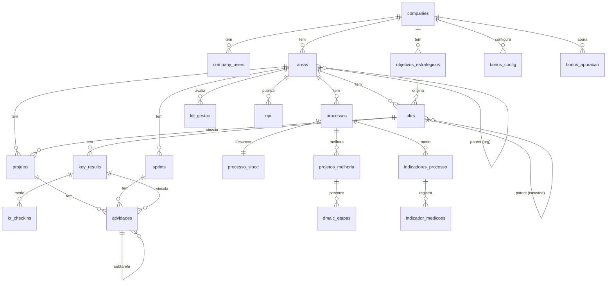

# 03 - Modelo de dados

Todas as tabelas vivem no schema `app`, carregam `company_id`, `created_at`,
`updated_at`, `created_by` e têm RLS com as 4 políticas. Aqui está o mapa lógico;
o SQL exato está em `supabase/migrations/`.

## Diagrama ER (visão macro)

## Entidades por domínio

### Tenant e organização

- **companies** - empresa. `tipo` (holding | controlada), `parent_company_id`
  (a holding é pai das controladas). `razao_social`, `nome_fantasia`.
- **company_users** - vínculo usuário-empresa. `is_admin`, `is_active`, `cargo`,
  `nivel` (diretor | gerente | gerente_regional | coordenador | especialista |
  colaborador). Único por (company_id, user_id).
- **profiles** - espelho de `auth.users` com `nome`, `email`, `avatar_url`.
- **areas** - unidade organizacional (diretoria, gerência, especialista). Árvore
  via `parent_area_id`. `tipo` (diretoria | gerencia | especialista | comite),
  `responsavel_user_id`. Reflete o organograma da empresa.

### Estratégia e OKR

- **perspectivas** - as 4 do BSC (financeiro, clientes, processos, aprendizagem).
  Lookup por empresa (ou global).
- **objetivos_estrategicos** - itens do mapa estratégico. `perspectiva_id`,
  `titulo`, `ciclo` (ex.: 2026-2029), `is_estrela_do_norte`.
- **okrs** - o objetivo desdobrável. `nivel` (corporativo | diretoria | gerencia
  | individual), `parent_okr_id` (o elo do desdobramento), `area_id`,
  `owner_user_id`, `objetivo_estrategico_id`, `perspectiva_id`, `ano`,
  `trimestre` (nulo = anual), `status`.
- **key_results** - resultado-chave. `tipo` (numerico | percentual | moeda |
  marco), `baseline`, `meta`, `atual`, `unidade`, `peso`, `direcao` (subir |
  descer), `farol` (derivado). 
- **kr_checkins** - histórico de medição do KR. `data`, `valor`, `comentario`,
  `autor_user_id`.

### Projetos, sprints e atividades

- **projetos** - projeto ou iniciativa de IA. `categoria` (estrutural | melhoria
  | ia | gestao_projetos | comite), `responsavel_user_id`,
  `patrocinador_user_id`, `status`, `prioridade`, datas previstas e reais,
  `okr_id` (vínculo com a estratégia), `progresso_pct`.
- **sprints** - ciclo de execução de uma área. `nome`, `objetivo`, `data_inicio`,
  `data_fim`, `status` (planejada | ativa | encerrada).
- **atividades** - a unidade de trabalho. `projeto_id`, `sprint_id`,
  `key_result_id` (todos opcionais), `parent_atividade_id` (subtarefa),
  `horizonte` (anual | trimestral | mensal | semanal | diario),
  `responsavel_user_id`, `status` (a_fazer | fazendo | revisao | concluido |
  bloqueado), `prioridade`, `data_prazo`, `estimativa_h`, `esforco_h`, `ordem`.

### Processos e Six Sigma

- **processos** - processo de negócio. `dono_user_id`, `tipo` (primario | apoio |
  gestao), `nivel_maturidade` (1-5), `status`.
- **processo_sipoc** - 1:1 com processo. `suppliers`, `inputs`, `steps` (jsonb),
  `outputs`, `customers`.
- **projetos_melhoria** - projeto Six Sigma. `processo_id`, `metodo` (dmaic |
  kaizen | just_do_it), `belt_user_id`, `fase_atual` (define | measure | analyze
  | improve | control), `problema`, `meta_smart`, `ganho_estimado`,
  `ganho_realizado`, `status`, datas.
- **dmaic_etapas** - tollgate de cada fase. `fase` (D|M|A|I|C), `entregaveis`
  (jsonb), `status`, `data_conclusao`, `aprovado_por`.
- **indicadores_processo** - métrica do processo. `tipo` (Y | X), `formula`,
  `unidade`, `meta`, `baseline`.
- **indicador_medicoes** - série temporal. `data`, `valor`, `origem` (manual |
  importacao | erp).

### Kit de gestão, OPR e bônus

- **kit_gestao** - status do Kit mínimo por área e período. `item`
  (mapa_estrategico | processos_procedimentos | opr), `status` (pendente | em_dia
  | atrasado), `percentual`, `avaliador_user_id`.
- **opr** - One Page Report mensal por área. `periodo` (ano-mês), `destaques`,
  `okr_resumo`, `indicadores` (jsonb snapshot), `riscos`, `proximos_passos`,
  `status` (rascunho | publicado), `autor_user_id`.
- **bonus_config** - modelo de bônus por empresa e ano. `pesos` (jsonb:
  global/setorial/individual e EBITDA/faturamento), `reguas` (jsonb: as faixas de
  pagamento por indicador e o multiplicador por nível).
- **bonus_apuracao** - atingimento apurado. `escopo` (global | area | individual),
  `area_id` ou `user_id`, `periodo`, `componente`, `atingimento_pct`, `peso`,
  `resultado_pct`.

## Convenções comuns

- Chaves primárias `uuid` com `gen_random_uuid()`.
- `company_id uuid not null references app.companies(id)` em toda tabela de
  negócio.
- `created_at` e `updated_at` `timestamptz not null default now()`, com trigger
  que atualiza `updated_at`.
- `created_by uuid references auth.users(id) default auth.uid()`.
- Enums implementados como colunas `text` com `check` (mais fáceis de evoluir que
  tipos `enum` nativos) ou tabelas de domínio quando o conjunto cresce.
- Índices: sempre em `company_id` e em cada FK usada em filtro; ordenação de
  paginação por chave única (`id`) para não corromper `.range()`.

## Faróis (regra de cor)

O farol de um KR e o progresso de um projeto usam os tokens semânticos do design
system (`success` / `warning` / `destructive`), calculados no banco a partir de
atingimento vs. tempo decorrido do ciclo, nunca com hex no componente.
