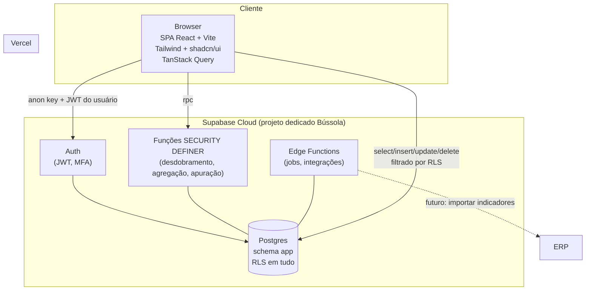

# Arquitetura (topologia)

Pontos de segurança marcados na topologia: o browser só carrega a `anon key`; a
`service_role` vive apenas em Edge Functions e scripts. Toda leitura e escrita
passa pela RLS. As RPCs privilegiadas têm gate próprio.
