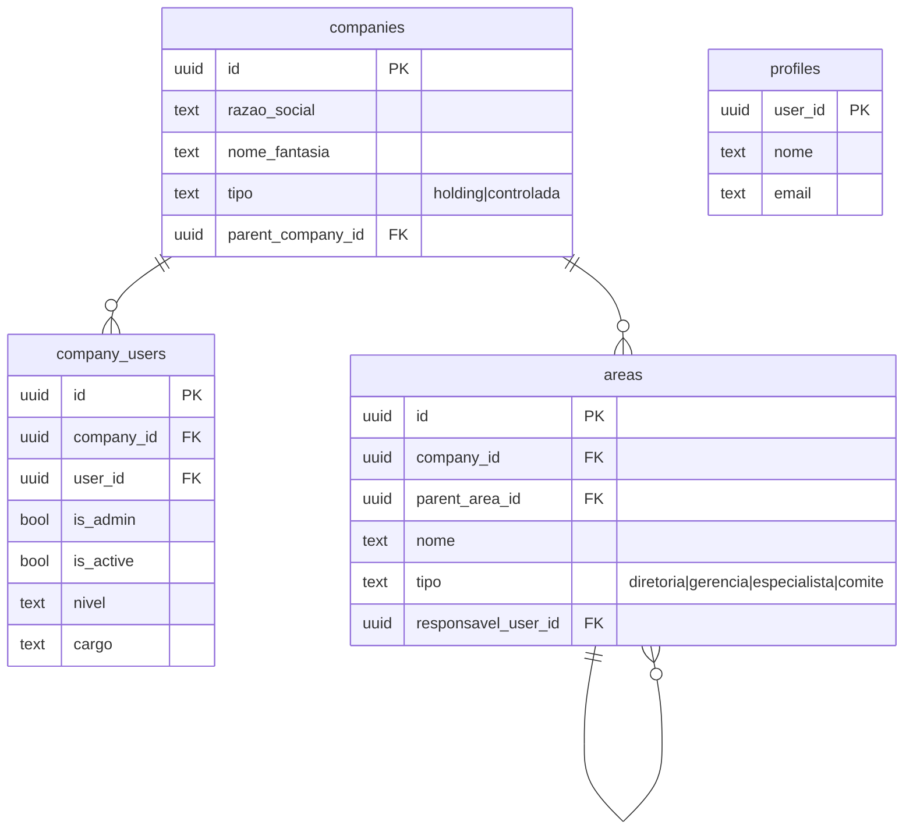
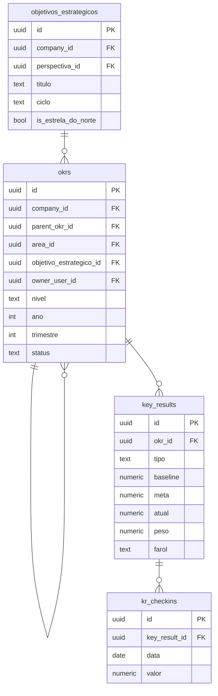
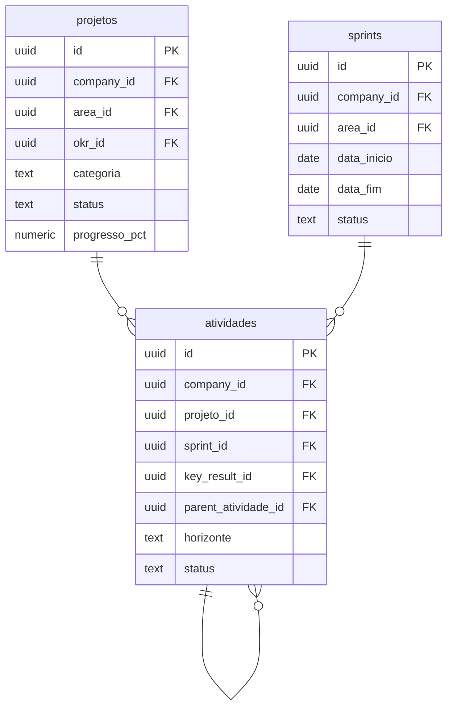
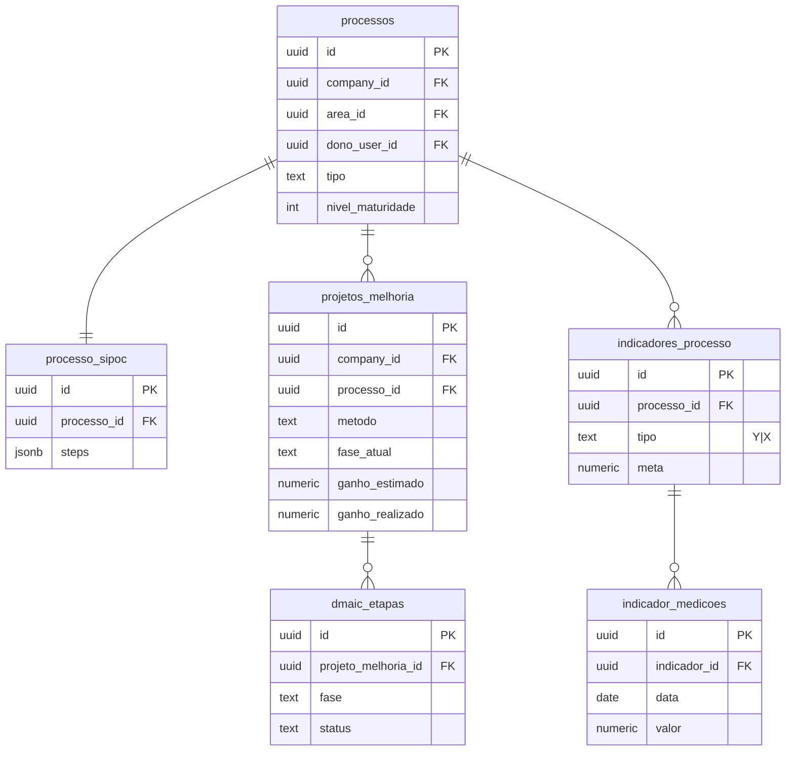

# Diagrama ER (referência)

Versão de referência do modelo. O ER macro comentado está em
`docs/03-modelo-de-dados.md`; aqui fica o detalhe por domínio.

## Tenant e organização

## OKR

## Projetos, sprints, atividades

## Processos / Six Sigma

