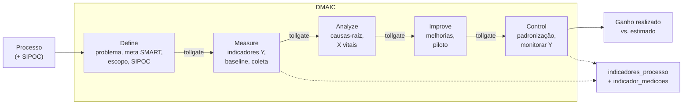

# Fluxo DMAIC (módulo de processos / Six Sigma)

Cada projeto de melhoria percorre as cinco fases com tollgate entre elas. As
etapas ficam em `dmaic_etapas`, uma por fase, com entregáveis e aprovação.

Melhorias menores não precisam do fluxo completo: `metodo` pode ser `kaizen` ou
`just_do_it`, que dispensam alguns tollgates. O ganho estimado e o realizado
conectam o esforço de melhoria ao objetivo "Implantação de melhoria" do mapa da
área.
