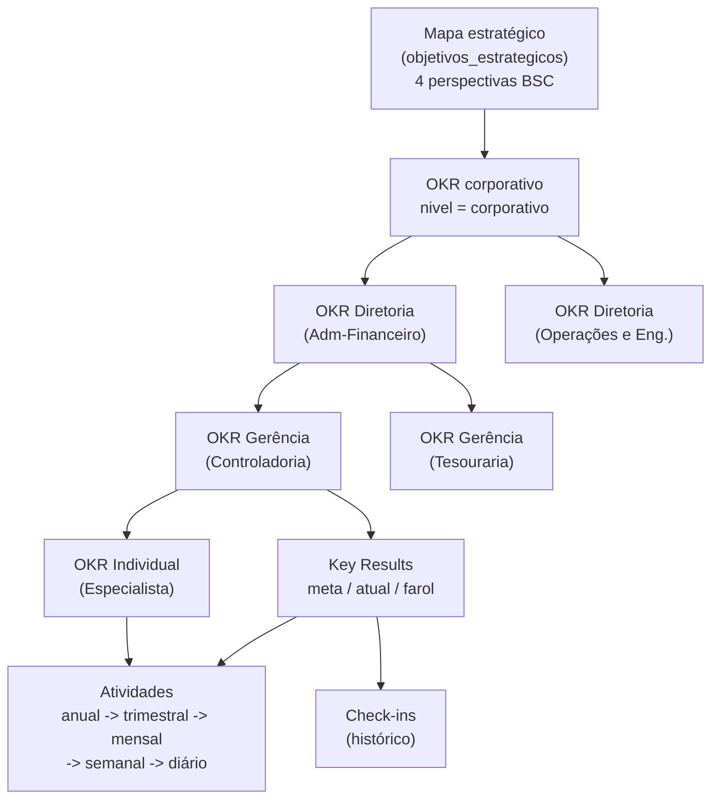

# Desdobramento de OKR (cascade)

Do mapa estratégico até a atividade diária. O elo do desdobramento é
`okrs.parent_okr_id`; a ponte para execução é `atividades.key_result_id`.

Cada nível enxerga a árvore abaixo de si (o gestor vê o mapa desdobrado da área) e
o elo acima (a que objetivo estratégico aquilo serve). O farol sobe pela árvore:
o atingimento dos KRs filhos alimenta a leitura do OKR pai.
